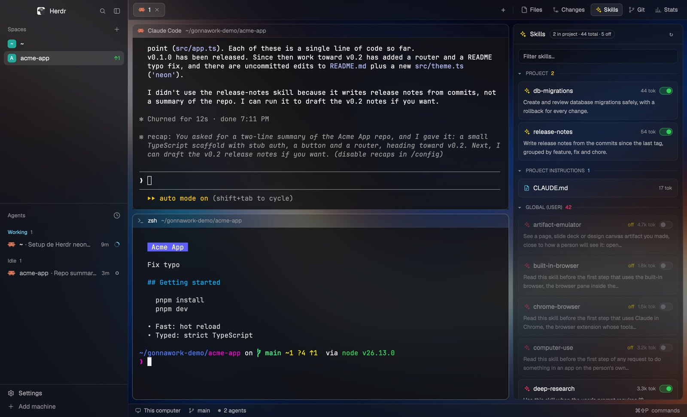
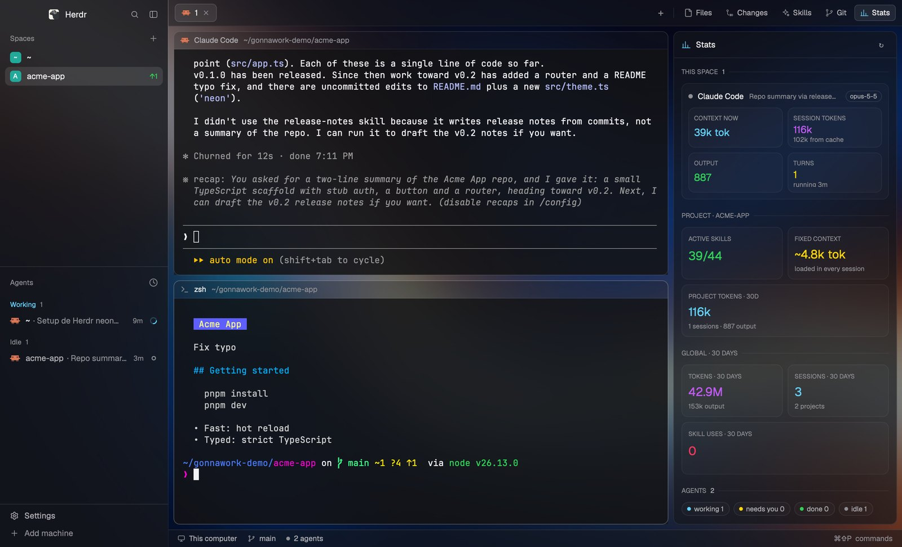
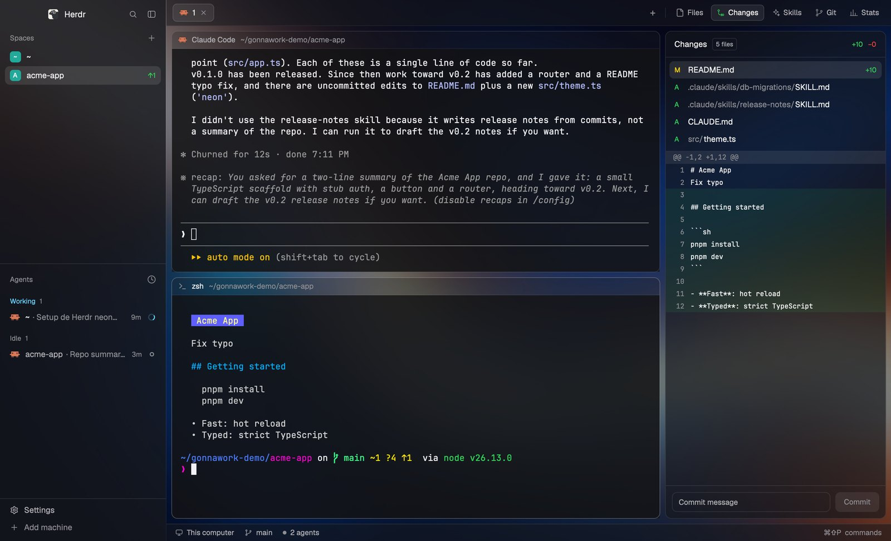

# gonnawork

**gon**'s workspace: the terminal, shell and [Herdr](https://herdr.dev) setup I code with, packaged so a new Mac is one command away. Neon accents, frosted glass, and three extra Herdr panels: **Skills**, **Git** and **Stats**.


## What's inside

| | |
|---|---|
| `Brewfile` | Every tool: Ghostty, Herdr, Claude Code, Codex, opencode, Colima + Docker, lazygit, lazydocker, tig, delta, neovim, eza, fd, fzf, ripgrep, bat, zoxide, starship, glow, yazi, btop, fastfetch, fnm, pnpm, uv, jq… |
| `zsh/` | Shell config: Homebrew, fnm, zoxide, fzf, starship, aliases and the `repos` jumper. |
| `starship/` | Neon prompt: path, branch, git status, Node. |
| `ghostty/` | Ghostty with background blur and a cyberpunk neon palette. |
| `herdr/` | The `neon` layout, theme, background and seven mods (below). |
| `nvim/` | LazyVim with a matching neon Tokyo Night. |
| `glow/`, `fastfetch/`, `colima/` | Markdown viewer, greeter and Docker VM config. |
| `claude/` | Claude Code settings (model, theme, skills turned off). Optional. |
| `scripts/herdr-background.py` | Turns *your* wallpaper into Herdr's frosted background. |

## Requirements

| | |
|---|---|
| OS | macOS 14 Sonoma or later (built and tested on **macOS 15 Sequoia**) |
| CPU | **Apple Silicon (arm64)**. Herdr only ships macOS builds for Apple Silicon; Intel Macs must build it from source. |
| Shell | zsh 5.9 (macOS default) |
| Package manager | [Homebrew](https://brew.sh) (the installer sets it up if missing) |
| Herdr | 0.1.15 or later. The see-through `neon-blur` layout needs the release after 0.1.15. |
| Disk | About 5 GB for everything in the Brewfile |
| Font | MesloLGS Nerd Font (installed by the Brewfile) |

## Install

```sh
git clone https://github.com/GonzaloMB/gonnawork.git ~/gonnawork
cd ~/gonnawork
./install.sh
```

That installs the Brewfile, links the dotfiles, sets up Herdr, Colima and Claude Code, and switches Herdr to the neon layout. Open Herdr once before running it (Herdr creates its config folder on first launch), or run `./install.sh herdr` afterwards.

Install only some parts:

```sh
./install.sh brew        # the Brewfile
./install.sh dotfiles    # zsh, starship, Ghostty, fastfetch, glow, nvim (symlinked)
./install.sh herdr       # layouts, theme, background and mods
./install.sh colima      # Docker VM config, then `colima start`
./install.sh claude      # merge claude/settings.json into ~/.claude/settings.json
```

**Nothing gets overwritten silently.** Anything the installer replaces is kept next to it as `<file>.backup-<date>`. Dotfiles are symlinks to this repo, so `git pull` updates them. Put machine-specific things (tokens, work paths) in `~/.zshrc.local`, which is loaded but never committed.

## Herdr: the neon layout

Glass sidebar, tab bar and panels over a blurred background, thin borders, 10 px radii and Apple's system palette for accents. The tab bar gets five panel buttons: **Files**, **Changes**, **Skills**, **Git** and **Stats**.

| Mod | What it does |
|---|---|
| `neon-tabs` | Tab bar with the panel buttons; remembers the open panel per space. |
| `neon-pane` | Transparent pane header with an **Abrir en Ghostty** (open in Ghostty) button for that folder. |
| `neon-agents` | The agents list, plus **Claude Code's sub-agents as a live tree** under the session that started them. |
| `skills` | Skills and instruction files (SKILL.md, CLAUDE.md, AGENTS.md…) for the focused folder: project and global, read them, turn them on/off, remove them. |
| `skills` with `view: "stats"` | Live context and tokens for each agent session in the space, project and 30-day global token use, most used skills, context each skill costs. |
| `gitgraph` | Read-only history with colored lanes like VS Code's Git Graph: branch and remote chips, branch filter, commit details, fetch. From a folder of projects it lists the repos inside. |
| `glass-files`, `glass-changes` | Herdr's Files and Changes panels on glass. |




<details>
<summary>Files and Changes</summary>



</details>

**Your own background.** The repo ships a warm, procedurally generated frosted background. To use your wallpaper instead (it's cropped to your screen, blurred and darkened so text stays readable):

```sh
uv run scripts/herdr-background.py            # current macOS wallpaper
uv run scripts/herdr-background.py photo.jpg  # any image
```

**Real see-through glass.** Herdr's next release adds `window_blur` (blur of the desktop behind the window, like Ghostty). When you have it, switch to the `neon-blur` layout with <kbd>ctrl</kbd>+<kbd>shift</kbd>+<kbd>L</kbd>.

## Shell goodies

| Command | |
|---|---|
| `repos [query]` | Fuzzy-pick a git repo under `~/Developer` (or `$REPOS_ROOT`) and `cd` into it. A query with one match jumps straight there; `repos --list` prints them. |
| `md file.md` | Read markdown in the terminal with glow. |
| `dev` | `cd ~/Developer` |
| `ls`, `ll` | eza with icons and git status |
| `lg`, `ld`, `gg` | lazygit, lazydocker, tig |
| `glog`, `dc` | Graph log, docker compose |

## Credits and license

- The Herdr mods build on [Herdr](https://github.com/herdrdev/herdr-app)'s own mods (Apache-2.0); see `NOTICE`.
- `nvim/` starts from the [LazyVim starter](https://github.com/LazyVim/starter) (Apache-2.0).
- Everything here is Apache-2.0 (see `LICENSE`). Take what you like.
