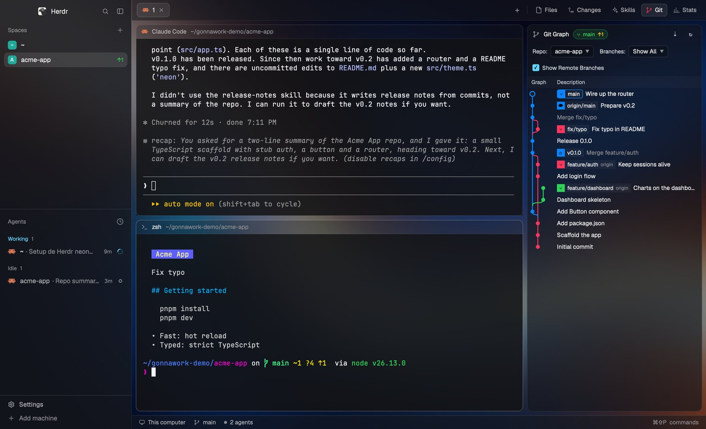
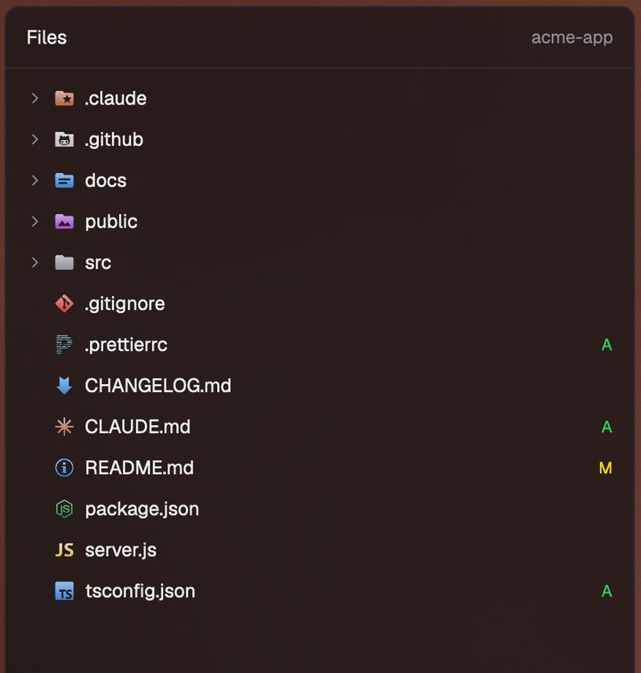
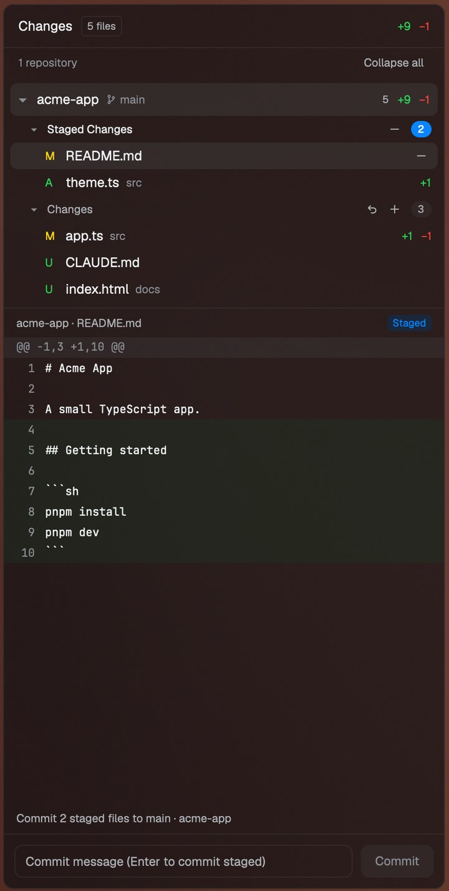
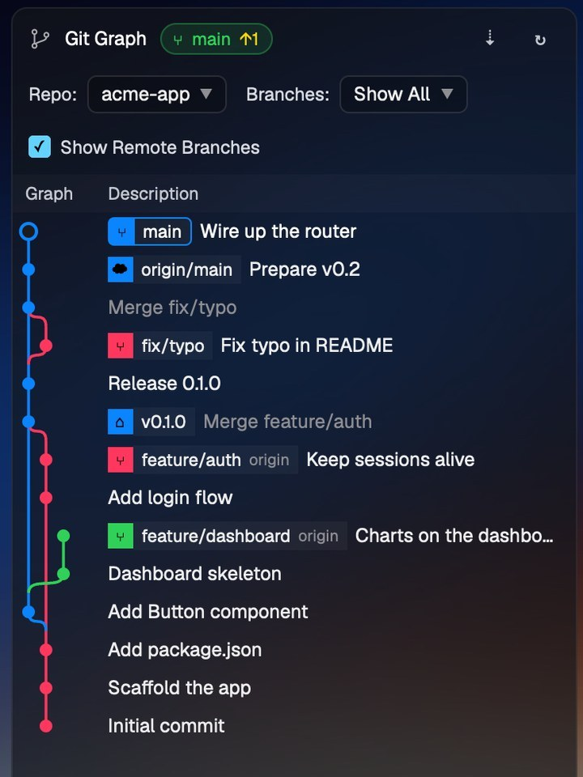
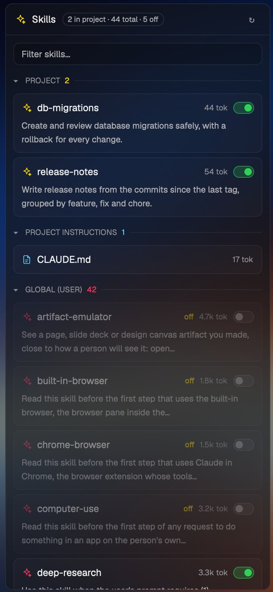
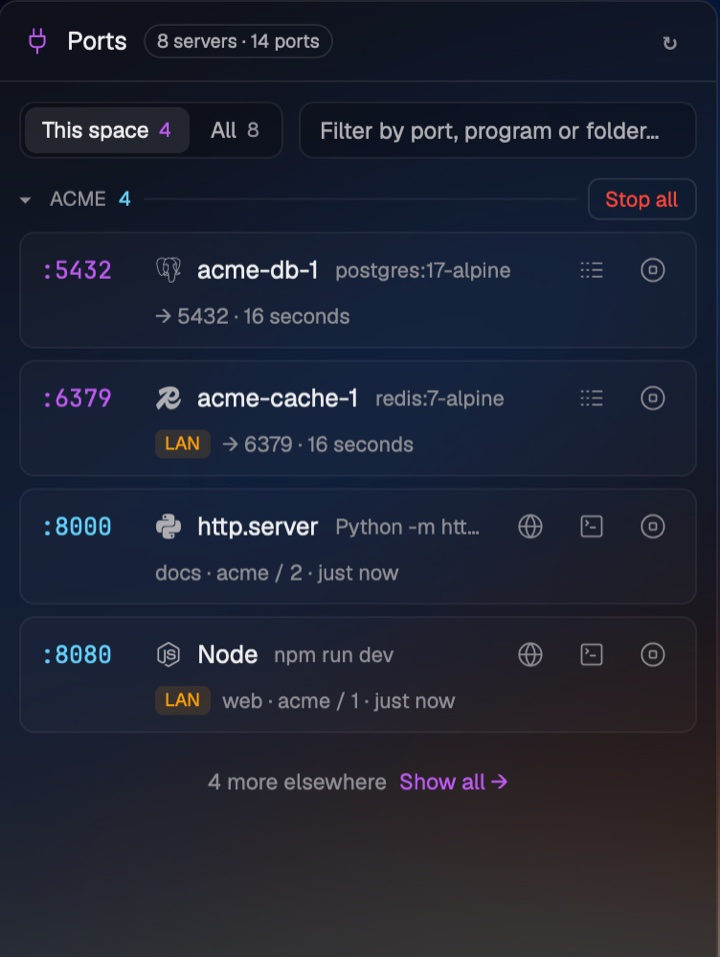
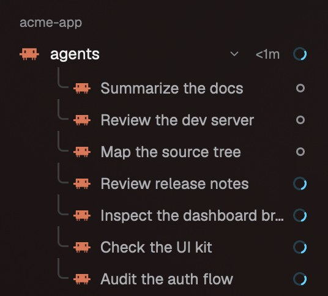

# gonnawork

A reusable macOS workspace for coding with agents: terminal tools, shell, editor and a [Herdr](https://herdr.dev) setup with neon accents, real frosted glass and six side panels: **Files**, **Changes**, **Skills**, **Git**, **Stats** and **Ports**. One command sets up a new Mac.



## Install

```sh
git clone https://github.com/GonzaloMB/gonnawork.git ~/gonnawork
cd ~/gonnawork
./install.sh
```

It installs the Brewfile, links the dotfiles, sets up Herdr, Colima and Claude Code, and switches Herdr to the `gonnawork-neon-blur` layout. Open Herdr once first (it creates its config folder on first launch), or run `./install.sh herdr` afterwards.

Or install only some parts:

```sh
./install.sh brew        # everything in the Brewfile
./install.sh dotfiles    # zsh, starship, Ghostty, fastfetch, glow, nvim (symlinked)
./install.sh herdr       # Herdr layouts, theme, background and mods
./install.sh colima      # Docker VM config, then run `colima start`
./install.sh claude      # merge claude/settings.json into ~/.claude/settings.json
```

**Nothing gets overwritten silently.** Anything the installer replaces is kept next to it as `<file>.backup-<date>` (old Herdr mods go to `~/.config/herdr-app/backups/`, so Herdr doesn't load them), and running it again changes nothing. Dotfiles are symlinks to this repo, so `git pull` updates them. Put machine-specific things (tokens, work paths) in `~/.zshrc.local`: it's loaded but never part of the repo.

**Updating from an earlier version?** The mods, layouts and theme now start with `gonnawork-` so they never clash with Herdr's own. `./install.sh herdr` moves the old unprefixed copies to `~/.config/herdr-app/backups/`. If you bound the Ports keys, rename them to `gonnawork-ports.*`.

## Requirements

| | |
|---|---|
| OS | macOS 14 Sonoma or later (built and tested on **macOS 15 Sequoia**) |
| CPU | **Apple Silicon (arm64)**. Herdr only ships macOS builds for Apple Silicon; Intel Macs must build it from source. |
| Shell | zsh 5.9 (macOS default) |
| Package manager | [Homebrew](https://brew.sh) (the installer sets it up if missing) |
| Herdr | **0.1.18 or later** (real glass needs its `window_blur`) |
| Disk | About 5 GB for everything in the Brewfile |
| Font | MesloLGS Nerd Font (installed by the Brewfile) |

## Tools

Everything comes from the `Brewfile`.

| Tool | What for |
|---|---|
| [Ghostty](https://ghostty.org) | GPU terminal, configured with background blur and a neon palette |
| [Herdr](https://herdr.dev) | Desktop app for terminals and coding agents (setup below) |
| [lazygit](https://github.com/jesseduffield/lazygit) · `lg` | Git in a TUI: stage hunks, commit, rebase, switch branches, resolve conflicts |
| [lazydocker](https://github.com/jesseduffield/lazydocker) · `ld` | Docker in a TUI: containers, logs, stats, restart, shell into a container |
| [Colima](https://github.com/abiosoft/colima) + Docker | Docker on macOS without Docker Desktop (`colima start`, then the usual `docker` / `dc`) |
| [zoxide](https://github.com/ajeetdsouza/zoxide) · `z` | Jump to folders you've been to: `z api`, `z front src`; `zi` to pick from a list |
| [fzf](https://github.com/junegunn/fzf) | Fuzzy finder: <kbd>ctrl</kbd>+<kbd>r</kbd> history, <kbd>ctrl</kbd>+<kbd>t</kbd> files, <kbd>alt</kbd>+<kbd>c</kbd> folders |
| [starship](https://starship.rs) | Prompt with path, branch, git status and Node version |
| [eza](https://github.com/eza-community/eza) · `ls`, `ll` | `ls` with icons and git status |
| [glow](https://github.com/charmbracelet/glow) · `md` | Read markdown in the terminal: `md README.md` |
| [neovim](https://neovim.io) + LazyVim | Editor, with a matching neon Tokyo Night |
| [tig](https://jonas.github.io/tig/) · `gg`, [delta](https://github.com/dandavison/delta) | Browse history; readable diffs |
| [yazi](https://github.com/sxyazi/yazi), [btop](https://github.com/aristocratsoftware/btop), [fastfetch](https://github.com/fastfetch-cli/fastfetch) | File manager, resource monitor, system info greeting |
| fd, ripgrep, bat, jq | Find files, search text, view files, process JSON |
| fnm, pnpm, uv, Python | Node versions (switch per folder), JS packages, Python packages |
| gh, git | GitHub CLI and git |
| Claude Code, Codex, opencode | Coding agents |
| tmux, tree-sitter | Multiplexer; parsers for nvim |

Aliases: `lg` lazygit · `ld` lazydocker · `gg` tig · `glog` graph log · `dc` docker compose · `md` glow · `ls` / `ll` eza.

## Herdr: the neon layout

Glass sidebar, tab bar and panels, thin borders, 10 px corners and Apple's system colors for accents. The tab bar has a button for each side panel: **Files**, **Changes**, **Skills**, **Git**, **Stats**, **Ports**. Herdr remembers which one was open in each space.

There are two versions of the layout; <kbd>ctrl</kbd>+<kbd>shift</kbd>+<kbd>L</kbd> switches between them:

| Layout | Glass |
|---|---|
| `gonnawork-neon-blur` (default) | **Real glass.** Herdr's `window_blur` (0.1.18+) blurs whatever is behind the window, like Ghostty does: your wallpaper, other windows. The glass is denser here, so text stays readable even with a white window behind. |
| `gonnawork-neon` | A frosted picture behind the window, the same on every Mac. The screenshots here use it. |

The panels below are shown on a demo repo.

### Files

<p align="center"></p>

The focused pane's folder as a tree, with **VS Code's icons**: Seti for files, Material for folders (`.github`, `.claude`, `docs`, `public`, `src`…), in Apple's system colors. Git status letters on the right (**M** modified, **A** added, **U** untracked). Click a file for a read-only preview: **Markdown opens rendered** (headings, lists, code, tables), with a toggle for the source. Follows `cd` as it happens.

In the terminal, `md README.md` renders Markdown too (glow, with a pager).

### Changes

<p align="center"></p>

Source control like VS Code's:

- **Each checkout is its own group**: the repo and its linked worktrees, or every repo directly inside a folder of projects.
- **Staged Changes** and **Changes** lists. Stage, unstage or discard a file or a whole list. Discard asks first and never touches staged work.
- **Click a file** for its diff: staged files against `HEAD`, the rest against what's staged.
- **Commit** takes only what's staged (it never runs `git add -A` for you). It waits up to 2 minutes for slow commit hooks.

### Git

<p align="center"></p>

A read-only history of the repo you're in, drawn like VS Code's Git Graph:

- **Colored lanes** for each branch, with curves where they merge. A ring marks `HEAD`.
- **Chips**: local branches, remote branches, tags. A branch and its remote on the same commit share one chip (`feature/auth origin`).
- **Header**: the current branch with how far ahead or behind its upstream it is (`main ↑1`).
- **Repo**: the repos open in the space's panes, the focused one first. From a folder of projects (one level above them), it lists the repos inside.
- **Branches**: filter the history to one branch, with search. It only filters; it never checks anything out.
- **Show Remote Branches** toggles remote branches.
- **Click a commit** to see its message and changed files.
- **⇣ Fetch** fetches all remotes. That's the only action that changes anything.
- Follows `cd` and checkouts as they happen.

### Stats

<p align="center"></p>

What your agents are doing and what they cost, from Claude Code's own transcripts in `~/.claude/projects`. It's all read locally; nothing leaves your machine.

- **This space**: a card for each agent in the space you're looking at: how much of its context window is in use, what the session would cost on the API, output, turns and cache hits.
- **Accounts**: with [claude-multi](#more-than-one-claude-account-claude-multi), every Claude account's 5-hour and weekly limits, which one is the default and when each resets.
- **Last 30 days**: the API-equivalent cost, output and sessions, cost per day, and where the tokens and the money go (input, cache writes, cache reads, output).
- **Per project** and **per model** over 30 days, then every agent's status (working, needs you, done, idle).

Costs are at API list prices: on a subscription they're a yardstick, not a bill.

### Skills

<p align="center"></p>

Every agent skill (`SKILL.md`) and instruction file (`CLAUDE.md`, `AGENTS.md`, `GEMINI.md`…) that applies to the focused pane's folder, **project and global together**:

- **Project**: skills in `.claude/skills`, `.agents/skills`, `.codex/skills`, `.opencode/skills` and `.cursor/skills`, from the folder up to the repo root.
- **Project instructions**: `CLAUDE.md`, `CLAUDE.local.md`, `AGENTS.md`, `GEMINI.md` along the same path.
- **Plugins**: skills from Claude Code plugins.
- **Global (user)**: `~/.claude/skills`, `~/.agents/skills`, `~/.codex/skills`, opencode's.
- **Global instructions**: `~/.claude/CLAUDE.md`, `~/.codex/AGENTS.md`.

Each card shows the size in tokens and a switch. Turning a skill off adds `Skill(<name>)` to `permissions.deny` in `~/.claude/settings.json`; the detail view can turn it off for **this project only** instead (`.claude/settings.local.json`). Click a card to read it (rendered markdown), open it with glow (**Read**) or your editor (**Open**), or **Remove** it: it's moved to `~/.claude/skills-removed/`, never deleted. A filter box searches names and descriptions.

### Ports

<p align="center"></p>

Everything listening on a TCP port, and a quick way to stop or restart it:

- **This space**: servers started from the space's terminals, plus anything running in its project folders (Docker Compose services included).
- **All**: everything, grouped by space, then **Outside Herdr** (started from another terminal), **Docker** and **Apps & system** (folded).
- **Each row**: the port, what it is (Next.js, Vite, Postgres, Redis…), the command, the folder, the terminal or agent that started it (`acme-app / dev`) and how long it's been up. **LAN** marks ports reachable from your network.
- **Open** it in the browser, **jump** to its terminal, or read a container's **logs**.
- **Restart**: a container gets `docker restart`. A server running in a Herdr terminal gets <kbd>ctrl</kbd>+<kbd>c</kbd> and, once the shell has its prompt back, its command is typed in again. Servers it can't restart safely (one an agent started, one outside Herdr) have no Restart button.
- **Stop**: a terminal's foreground job gets <kbd>ctrl</kbd>+<kbd>c</kbd> (SIGINT to its process group, so `npm` and its children go too), a background job SIGTERM, a container `docker stop`. Still up after 3 seconds, it offers **Force**. **Stop all** stops a whole group.
- **Everything asks first**: Stop, Restart, Force and Stop all open a dialog saying what will be sent, to which process and where it was started.
- **Apps & system are read-only**: they're listed so you know what holds a port, but they have no Stop or Force kill, so nothing in macOS or your apps breaks. The same goes for an agent's own port and Herdr's.
- **Click a row** for the full command, pid and what Stop and Restart will do, plus **Copy URL**, **Terminal here** and **Force kill** (asks first).
- Refreshes every 3 s while open, every 20 s while closed. In a space on another machine it lists that machine's ports (`lsof`, or `ss` on Linux).
- Keys: bind `gonnawork-ports.space`, `gonnawork-ports.all` or `gonnawork-ports.refresh` in `keys.json`.

### Sub-agents in the agents list

<p align="center"></p>

Claude Code's sub-agents (its Agent/Task tool) run inside the main process, so Herdr doesn't see them. The `gonnawork-neon-agents` mod reads them from the session's transcripts and shows them **as a tree under the session that started them**: a spinner while they work, a dot once they're done, nested when a sub-agent starts others. Click one to follow it in a window: its prompt, every tool call with its answer, and its report to the parent.

### The mods

| Mod | |
|---|---|
| `gonnawork-neon-tabs` | Tab bar with the panel buttons |
| `gonnawork-neon-pane` | Transparent pane header with a button that opens the pane's folder in Ghostty |
| `gonnawork-neon-agents` | Agents list with Claude Code sub-agents as a tree |
| `gonnawork-glass-files` | The Files panel |
| `gonnawork-glass-changes` | The Changes panel |
| `gonnawork-gitgraph` | The Git panel |
| `gonnawork-stats` | The Stats panel |
| `gonnawork-skills` | The Skills panel |
| `gonnawork-ports` | The Ports panel |

### Your own wallpaper behind the frosted picture

`gonnawork-neon` ships a warm, generated frosted background. To use your own wallpaper instead (cropped to your screen, blurred and darkened so text stays readable):

```sh
uv run scripts/herdr-background.py            # your current macOS wallpaper
uv run scripts/herdr-background.py photo.jpg  # any image
```

With `gonnawork-neon-blur` you don't need this: the real wallpaper shows through.

## More than one Claude account: claude-multi

Coding with agents all day burns through a Claude Pro plan's limits. [**claude-multi**](https://github.com/GonzaloMB/claude-multi) runs several Claude Code accounts as one: when an account hits its usage limit, Claude asks where to carry on and the same conversation continues on the next account, in one keypress. Two Pro accounts give you twice the usage for a fraction of the price of Max.

It's a separate install (macOS and zsh, like this repo):

```sh
curl -fsSL https://raw.githubusercontent.com/GonzaloMB/claude-multi/main/install.sh | zsh
```

With it installed, the **Stats** panel shows every account's limits (the screenshot above has three).

## Credits and license

- The Herdr mods build on [Herdr](https://github.com/herdrdev/herdr-app)'s own mods (Apache-2.0); the file icons come from [Nerd Fonts](https://www.nerdfonts.com) glyphs. See `NOTICE`.
- `nvim/` starts from the [LazyVim starter](https://github.com/LazyVim/starter) (Apache-2.0).
- Everything here is Apache-2.0 (see `LICENSE`). Take what you like.
