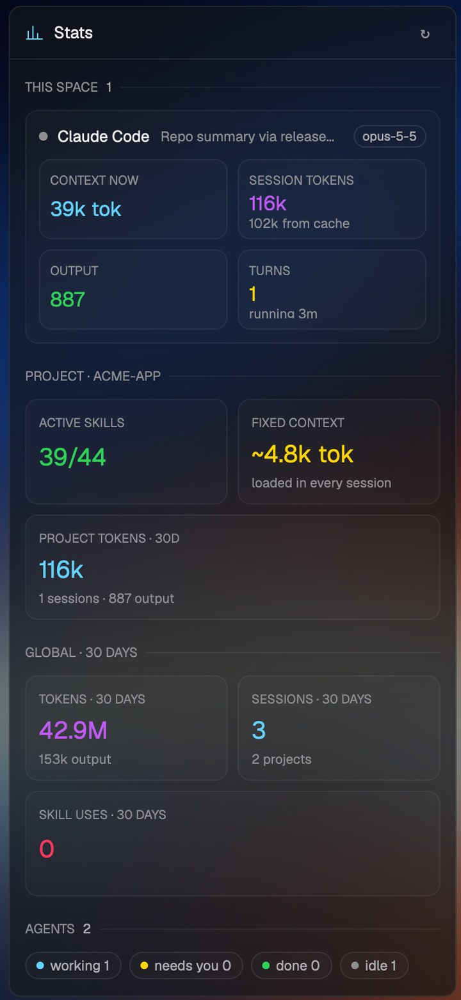
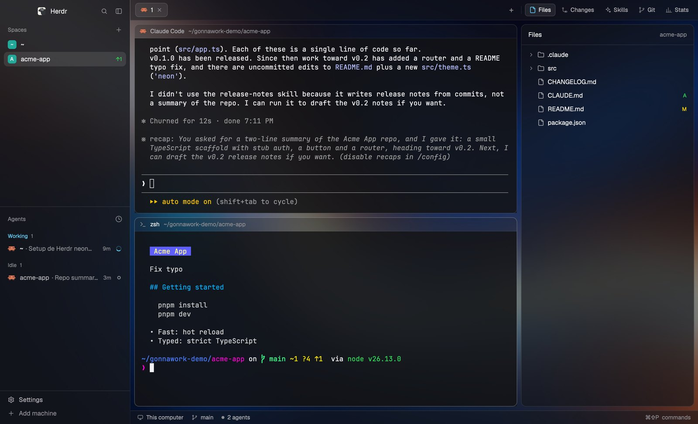

# gonnawork

A reusable macOS workspace for coding with agents: terminal tools, shell, editor and a [Herdr](https://herdr.dev) setup with neon accents, frosted glass and four extra panels (**Skills**, **Git**, **Stats**, **Ports**). One command sets up a new Mac.


## Install

```sh
git clone https://github.com/GonzaloMB/gonnawork.git ~/gonnawork
cd ~/gonnawork
./install.sh
```

It installs the Brewfile, links the dotfiles, sets up Herdr, Colima and Claude Code, and switches Herdr to the neon layout. Open Herdr once first (it creates its config folder on first launch), or run `./install.sh herdr` afterwards.

Or install only some parts:

```sh
./install.sh brew        # everything in the Brewfile
./install.sh dotfiles    # zsh, starship, Ghostty, fastfetch, glow, nvim (symlinked)
./install.sh herdr       # Herdr layouts, theme, background and mods
./install.sh colima      # Docker VM config, then run `colima start`
./install.sh claude      # merge claude/settings.json into ~/.claude/settings.json
```

**Nothing gets overwritten silently.** Anything the installer replaces is kept next to it as `<file>.backup-<date>`, and running it again changes nothing. Dotfiles are symlinks to this repo, so `git pull` updates them. Put machine-specific things (tokens, work paths) in `~/.zshrc.local`: it's loaded but never part of the repo.

## Requirements

| | |
|---|---|
| OS | macOS 14 Sonoma or later (built and tested on **macOS 15 Sequoia**) |
| CPU | **Apple Silicon (arm64)**. Herdr only ships macOS builds for Apple Silicon; Intel Macs must build it from source. |
| Shell | zsh 5.9 (macOS default) |
| Package manager | [Homebrew](https://brew.sh) (the installer sets it up if missing) |
| Herdr | 0.1.15 or later. The see-through `neon-blur` layout needs the release after 0.1.15. |
| Disk | About 5 GB for everything in the Brewfile |
| Font | MesloLGS Nerd Font (installed by the Brewfile) |

## Tools

Everything comes from the `Brewfile`.

| Tool | What for |
|---|---|
| [Ghostty](https://ghostty.org) | GPU terminal, configured with background blur and a neon palette |
| [Herdr](https://herdr.dev) | Desktop app for terminals and coding agents (setup below) |
| [lazygit](https://github.com/jesseduffield/lazygit) · `lg` | Git in a TUI: stage hunks, commit, rebase, switch branches, resolve conflicts |
| [lazydocker](https://github.com/jesseduffield/lazydocker) · `ld` | Docker in a TUI: containers, logs, stats, restart, shell into a container |
| [Colima](https://github.com/abiosoft/colima) + Docker | Docker on macOS without Docker Desktop (`colima start`, then the usual `docker` / `dc`) |
| [zoxide](https://github.com/ajeetdsouza/zoxide) · `z` | Jump to folders you've been to: `z api`, `z front src`; `zi` to pick from a list |
| [fzf](https://github.com/junegunn/fzf) | Fuzzy finder: <kbd>ctrl</kbd>+<kbd>r</kbd> history, <kbd>ctrl</kbd>+<kbd>t</kbd> files, <kbd>alt</kbd>+<kbd>c</kbd> folders |
| [starship](https://starship.rs) | Prompt with path, branch, git status and Node version |
| [eza](https://github.com/eza-community/eza) · `ls`, `ll` | `ls` with icons and git status |
| [glow](https://github.com/charmbracelet/glow) · `md` | Read markdown in the terminal: `md README.md` |
| [neovim](https://neovim.io) + LazyVim | Editor, with a matching neon Tokyo Night |
| [tig](https://jonas.github.io/tig/) · `gg`, [delta](https://github.com/dandavison/delta) | Browse history; readable diffs |
| [yazi](https://github.com/sxyazi/yazi), [btop](https://github.com/aristocratsoftware/btop), [fastfetch](https://github.com/fastfetch-cli/fastfetch) | File manager, resource monitor, system info greeting |
| fd, ripgrep, bat, jq | Find files, search text, view files, process JSON |
| fnm, pnpm, uv, Python | Node versions (switch per folder), JS packages, Python packages |
| gh, git | GitHub CLI and git |
| Claude Code, Codex, opencode | Coding agents |
| tmux, tree-sitter | Multiplexer; parsers for nvim |

Aliases: `lg` lazygit · `ld` lazydocker · `gg` tig · `glog` graph log · `dc` docker compose · `md` glow · `ls` / `ll` eza.

## Herdr: the neon layout

Glass sidebar, tab bar and panels over a blurred background, thin borders, 10 px corners and Apple's system colors for accents. The tab bar has a button for each side panel: **Files**, **Changes**, **Skills**, **Git**, **Stats**, **Ports**. Herdr remembers which one was open in each space.

### Git

<p align="center"></p>

A read-only history of the repo you're in, drawn like VS Code's Git Graph:

- **Colored lanes** for each branch, with curves where they merge. A ring marks `HEAD`.
- **Chips**: local branches, remote branches, tags. A branch and its remote on the same commit share one chip (`feature/auth origin`).
- **Header**: the current branch with how far ahead or behind its upstream it is (`main ↑1`).
- **Repo**: the repos open in the space's panes, the focused one first. From a folder of projects (one level above them), it lists the repos inside.
- **Branches**: filter the history to one branch, with search. It only filters; it never checks anything out.
- **Show Remote Branches** toggles remote branches.
- **Click a commit** to see its message and changed files.
- **⇣ Fetch** fetches all remotes. That's the only action that changes anything.
- Follows `cd` and checkouts as they happen.

### Skills

<p align="center"></p>

Every agent skill (`SKILL.md`) and instruction file (`CLAUDE.md`, `AGENTS.md`, `GEMINI.md`…) that applies to the focused pane's folder, **project and global together**:

- **Project**: skills in `.claude/skills`, `.agents/skills`, `.codex/skills`, `.opencode/skills` and `.cursor/skills`, from the folder up to the repo root.
- **Project instructions**: `CLAUDE.md`, `CLAUDE.local.md`, `AGENTS.md`, `GEMINI.md` along the same path.
- **Plugins**: skills from Claude Code plugins.
- **Global (user)**: `~/.claude/skills`, `~/.agents/skills`, `~/.codex/skills`, opencode's.
- **Global instructions**: `~/.claude/CLAUDE.md`, `~/.codex/AGENTS.md`.

Each card shows the size in tokens and a switch. Turning a skill off adds `Skill(<name>)` to `permissions.deny` in `~/.claude/settings.json`; the detail view can turn it off for **this project only** instead (`.claude/settings.local.json`). Click a card to read it (rendered markdown), open it with glow (**Read**) or your editor (**Open**), or **Remove** it: it's moved to `~/.claude/skills-removed/`, never deleted. A filter box searches names and descriptions.

### Stats

<p align="center"></p>

What your agents are doing and what they cost, from Claude Code's own transcripts in `~/.claude/projects`. It's all read locally; nothing leaves your machine.

- **This space**: a card for each agent in the space you're looking at. It shows its model, context in use right now, session tokens (and how many came from cache), output, turns, how long it's been running, and skills used. Agents sharing a folder still get their own session (matched through the agent's process).
- **Project**: active skills, the fixed context they add to every session, and the project's tokens over 30 days.
- **Global · 30 days**: tokens, sessions, projects and skill uses across everything.
- **Agents**: how many are working, need you, are done or idle, with sub-agents as a tree.
- **Bars**: most used skills, estimated spend (uses × size), heaviest skills, fixed context per skill, and tokens per project.

### Ports

<p align="center"></p>

Everything listening on a TCP port, and a quick way to stop it:

- **This space**: servers started from the space's terminals, plus anything running in its project folders (Docker Compose services included).
- **All**: everything, grouped by space, then **Outside Herdr** (started from another terminal), **Docker** and **Apps & system** (folded).
- **Each row**: the port, what it is (Next.js, Vite, Postgres, Redis…), the command, the folder, the terminal or agent that started it (`Claude Code · api / 1`) and how long it's been up. **LAN** marks ports reachable from your network.
- **Open** it in the browser, **jump** to its terminal, or read a container's **logs**.
- **Stop** always asks first, saying what it will send and where the process was started. A terminal's foreground job gets <kbd>ctrl</kbd>+<kbd>c</kbd> (SIGINT to its process group, so `npm` and its children go too), a background job SIGTERM, a container `docker stop`. Still up after 3 seconds, it offers **Force**, which asks too. **Stop all** stops a whole group, after one confirmation.
- **Restart** asks first too. A container gets `docker restart`. A server running in a Herdr terminal's foreground gets <kbd>ctrl</kbd>+<kbd>c</kbd>, and once the shell has its prompt back, its command is typed in again (the dialog shows that command). Other servers, like one an agent started or one outside Herdr, have no Restart, because the panel can't tell how they were started.
- **Apps & system are read-only**: they're listed so you know what holds a port, but they have no Stop or Force kill, so nothing in macOS or your apps breaks. The same goes for an agent's own port and Herdr's.
- **Click a row** for the full command, pid and what Stop and Restart will do, plus **Copy URL**, **Terminal here** and **Force kill** (asks first).
- Refreshes every 3 s while open, every 20 s while closed. In a space on another machine it lists that machine's ports (`lsof`, or `ss` on Linux).
- Keys: bind `ports.space`, `ports.all` or `ports.refresh` in `keys.json`.

### Sub-agents in the agents list

Claude Code's sub-agents (its Agent/Task tool) run inside the main process, so Herdr doesn't see them. The `neon-agents` mod reads them from the session's transcripts and shows them **as a tree under the session that started them**, with a spinner while they work, nested when a sub-agent starts others. Clicking one takes you to its session.

### Files and Changes

<details>
<summary>Screenshots</summary>



</details>

Herdr's own Files panel, on glass. The Changes panel works like VS Code's Source Control:

- **Every checkout is its own group**: the repo you're in plus its linked worktrees (tagged `worktree`, with their branch). From a folder that holds several repos, it lists each repo directly inside it.
- **Staged Changes** and **Changes** are separate lists. A file changed in both shows in both, and its diff is the staged one (index vs HEAD) or the working-tree one (working tree vs index).
- **Hover a file** for **+** (stage), **−** (unstage) and **↶** (discard). Each section header does the same for all its files.
- **Discard always asks first**. It restores tracked files from the index, so staged work is kept, and deletes untracked files.
- **Commit takes only what's staged** (Enter in the message box or the button). Nothing gets added for you, and the line above the box says how many files go to which branch.
- Groups and sections fold, and Herdr remembers it. **Collapse all** folds every repo.

### The mods

| Mod | |
|---|---|
| `neon-tabs` | Tab bar with the panel buttons |
| `neon-pane` | Transparent pane header with a button that opens the pane's folder in Ghostty |
| `neon-agents` | Agents list with Claude Code sub-agents as a tree |
| `skills` | The Skills panel, and the Stats panel with `props: { "view": "stats" }` |
| `gitgraph` | The Git panel |
| `ports` | The Ports panel |
| `glass-files` | Files on glass |
| `glass-changes` | Changes on glass: stage, unstage, discard and commit, per repo and worktree |

### Background and real glass

The repo ships a warm, generated frosted background. To use your own wallpaper instead (cropped to your screen, blurred and darkened so text stays readable):

```sh
uv run scripts/herdr-background.py            # your current macOS wallpaper
uv run scripts/herdr-background.py photo.jpg  # any image
```

Herdr's next release adds `window_blur`: real blur of whatever is behind the window, like Ghostty. When you have it, switch to the `neon-blur` layout with <kbd>ctrl</kbd>+<kbd>shift</kbd>+<kbd>L</kbd>.

## Credits and license

- The Herdr mods build on [Herdr](https://github.com/herdrdev/herdr-app)'s own mods (Apache-2.0); see `NOTICE`.
- `nvim/` starts from the [LazyVim starter](https://github.com/LazyVim/starter) (Apache-2.0).
- Everything here is Apache-2.0 (see `LICENSE`). Take what you like.
